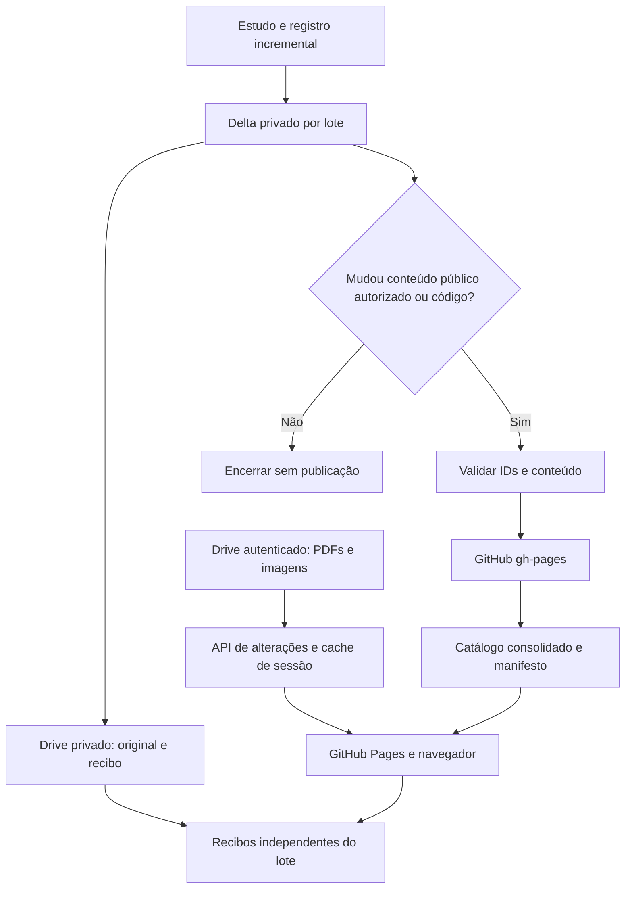

# Banco Mestre — documentação técnica e histórico de eficiência

**Marco de referência:** 24/11/2026 · Portal V371 · branch `gh-pages`  
**Produção:** https://carlosemichelon.github.io/concurso/  
**Revisão de código auditada:** [29116db](https://github.com/carlosemichelon/concurso/commit/29116db47a477279c9ea9226905a5422604bb962)  
**Status:** publicação e validação técnica aprovadas; homologação privada e liberação editorial integral não concluídas.

Este documento é o registro técnico consolidado e cumulativo do site. Atualizar este mesmo arquivo após melhorias relevantes, sem criar relatório por sessão de estudo, sem substituir a Metodologia Mestre privada e sem publicar dados pessoais. Os documentos antigos e commits continuam como evidência histórica.

## 1. Arquitetura e responsabilidades

| Camada | Fonte / implementação | Responsabilidade |
|---|---|---|
| Portal | GitHub Pages, `gh-pages`, `index.html` | Interface, leitura, filtros, revisão e integrações |
| Versão | [assets/version.json](../assets/version.json) | Manifesto vigente, contrato, contagens, versão anterior e metadados de publicação |
| Catálogo público | `assets/catalog_snapshot_v362.json` | Snapshot consolidado dos cartões autorizados, sem histórico privado |
| Geração do catálogo | `tools/catalog_snapshot.cjs` | Reconstrução determinística das fontes públicas, validação de contagens, hash e paridade |
| Renderização | JS/CSS em `assets/` | Leitor principal, prévia lateral, módulos didáticos, relações, fórmulas, tabelas e mídia |
| Biblioteca de PDFs | Google Drive autenticado; referências estáticas históricas | Inventário de originais e consulta pelo navegador |
| Atlas de imagens | Google Drive autenticado e índice editorial por ID | Original e prévias; SVGs públicos autorizados em arquivos versionados |
| Dados pessoais | Drive privado e armazenamento local conforme módulo | SRS, lacunas, anotações, grifos, tentativas, backups |
| Encerramento | Delta privado e `tools/study_batch.cjs` | Identidade, idempotência, hash, recibos e retomada |
| Validação | GitHub Actions, Node e Playwright | Integridade, regressão técnica, navegador e portão editorial separado |

### Fluxo lógico



O navegador não é fonte canônica dos cartões nem substitui o registro privado. Publicar código, publicar conteúdo didático autorizado, gravar SRS e consultar mídia são operações diferentes. A branch `main` é histórica; não promover mudanças por ela como se fosse produção.

## 2. Linha de base auditada (V371)

| Indicador | Valor | Natureza |
|---|---:|---|
| Cartões canônicos | 1.632 | Manifesto e navegador CI |
| Cartões ativos | 1.615 | Manifesto e navegador CI |
| Cartões inativos | 17 | Diferença das duas contagens |
| Propostas editoriais Ijuí separadas | 22 | Manifesto; não contar como SRS |
| Entradas combinadas | 1.654 | 1.632 + 22 |
| Referências históricas de PDF | 78 | Não é contagem atual autenticada |
| JS externos declarados | 42 | Contrato do portal |
| CSS externos declarados | 17 | Contrato do portal |
| Total declarado JS + CSS | 59 | Não é número total de requisições da rede |
| Catálogo público consolidado | 2.064.625 bytes | Tamanho bruto Git, antes de eventual compressão HTTP |
| HTML de entrada | 87.093 bytes | Tamanho bruto Git; index e V371 com blob idêntico |
| Bundle Drive V370 | 110.101 bytes | Tamanho bruto Git |
| Bundle Drive V371 | 115.724 bytes | Tamanho bruto Git; +5.623 bytes para a nova lógica |

A versão do portal e a versão do catálogo são independentes. O catálogo V362 tem blob Git `1ccd31fd35f25ecb9f4262161f88da345a3ee270`; na V371 é reutilizado sem alteração de dados. O tamanho de transferência real, latência, uso de CPU/memória e quantidade de PDFs/imagens privados não foram medidos nesta auditoria.

## 3. Registro cronológico de otimizações

| Marco | Problema | Mudança | Evidência / limite |
|---|---|---|---|
| V277/V298 | Muitas folhas CSS e cascata dispersa | Consolidação literal de estilos, com fontes e rollback preservados | Testes históricos de equivalência de bundles; V298 registrou 29 → 16 CSS |
| V316 | 160 scripts individuais na geração anterior e 24 folhas CSS | Núcleo distribuído em 14 pacotes ordenados; 24 CSS → 5 + 1 de lacunas; imagens recolhidas; SRS e interface compactados | Manifesto release_v316; 14 é quantidade de pacotes do núcleo, não total de scripts da V316 |
| V318 | Navegação intermediária e bloqueio inicial | Entrada direta, remoção de tela bloqueante e fonte remota bloqueante; defer em 16 scripts posteriores ao núcleo | release_v318; sem cronometagem real |
| V319–V324 | Leitor lateral recriado, navegação confusa e prévia invisível | Consulta de módulos sob demanda, correção de CSS que ocultava containers, lateral única e retorno com estado preservado | release_v319, release_v323, release_v324 |
| V326 | Consultas e repinturas periódicas desnecessárias | Remoção das varreduras de 2 min e retomada de aba no Atlas/checkpoints; sincronização por edição ou demanda; remoção de repinturas periódicas | release_v326; tráfego real ainda não quantificado |
| V349 | Respostas-modelo incompletas entre leitores | Leitor principal e lateral compartilhando apresentação restaurada de 207 cartões | release_v349; integridade de conteúdo, não benchmark de velocidade |
| V362 | Montagem pública por dezenas de fontes no navegador | Catálogo pré-consolidado, cache e caminho legado de contingência | 33 → 1 requisição de catálogo na rota normal; não são todas as requisições do site |
| V363–V364 | Repetição de leitura e normalização durante busca; encerramento repetitivo | Contrato independente, cache de metadados e índice textual, registro privado retomável | release_v363/v364 |
| V367 | Pesquisa lateral custosa e carregamento antecipado de versos | Índice textual por identidade, ordenação pré-calculada, relações/verso sob demanda | release_v367: 90 testes isolados de busca e mutação de índice registrados |
| V368 | Quatro módulos de complementos e leitura antecipada | Quatro scripts → um; pacotes por ID sob demanda; reutilização de Promise concorrente | release_v368: zero fetch antecipado dos quatro pacotes no teste isolado |
| V369 | Manifesto e testes antigos divergiam da produção | Contrato vigente coerente, inventário SVG e regressões históricas isoladas | [01560f7](https://github.com/carlosemichelon/concurso/commit/01560f7b54466a1c980b9f04df4b11090dc74269); 59 recursos declarados sem repetição; 46 SVGs restaurados e 92 referências conferidas |
| V369 manutenção | Repetição de tarefas administrativas e testes históricos rígidos | Identificação das etapas elegíveis do lote; testes históricos apontam para versões correspondentes | [9739d40](https://github.com/carlosemichelon/concurso/commit/9739d40df311abbf0473292cd7f00e8f3331c8c9); 7/7 rotinas executadas |
| V370 | Miniatura e leitor podiam baixar a mesma imagem simultaneamente | Single-flight por ID, revisão, MIME e autorização; mapa por ID; invalidação de respostas obsoletas | [9369a99](https://github.com/carlosemichelon/concurso/commit/9369a9931bfb883ff681757e91b4f58465bdd0ca); 5 testes específicos; 16/17 rotinas |
| V371 | Reconsultar toda a árvore do Drive para mudanças localizadas | API changes.list e cache de listagens por pasta durante a mesma sessão; reconsulta seletiva e fallback integral | [29116db](https://github.com/carlosemichelon/concurso/commit/29116db47a477279c9ea9226905a5422604bb962); 8 testes específicos; 16/17 rotinas |

Os marcos acima descrevem as otimizações documentadas; não significam que versões intermediárias devam ser reinstaladas nem que todos os ganhos permaneçam numericamente iguais após crescimento do acervo. As contagens históricas são comparáveis somente dentro do escopo de cada métrica.

## 4. Ganhos quantificáveis e limites

- **Catálogo:** 33 → 1 requisição normal, redução de 32/33 (aprox. 97,0%) nesse carregador. O teste Playwright V371 confirma uma única requisição ao snapshot.
- **Complementos:** 4 → 1 script específico (75% menos declarações desse conjunto), com leitura sob demanda.
- **Imagem repetida:** duas chamadas simultâneas idênticas podem compartilhar uma única transferência (50% de redução nesse cenário). Arquivos diferentes ou revisões diferentes não são agrupados.
- **Drive incremental:** se uma árvore possui 100 pastas e somente duas são afetadas por arquivos alterados, a próxima consulta elegível pode reler 2 em vez de 100 pastas, reaproveitando 98. Sem alteração elegível, pode não reler nenhuma pasta. Exemplo teórico: não inclui chamadas ao feed, paginação nem fallback, e não é medição no acervo real.
- **Reconciliação:** indexação por Map evita procurar repetidamente em toda a lista de imagens; não se atribui percentual de CPU sem benchmark.

Não somar percentuais de componentes diferentes nem apresentar redução de latência global como medida já realizada.

## 5. Sincronização V371: funcionamento e salvaguardas

1. Autorizar a conta Google durante a visita. Nenhuma nova permissão foi adicionada na V371.
2. Na leitura inicial, validar as raízes monitoradas, capturar cursor de início do histórico e percorrer a árvore completa.
3. Em nova leitura dentro da sessão, consultar e paginar o histórico de alterações desde o cursor anterior.
4. Identificar as pastas de origem e destino de arquivos incluídos, modificados, excluídos ou movidos; invalidar suas listagens e reconstruir a biblioteca com as restantes.
5. Confirmar o novo resultado somente após consulta completa bem-sucedida, mantendo os IDs e as regras de filtragem.
6. Fazer varredura completa se houver mudanças estruturais de pastas, remoção desconhecida, histórico inválido/indisponível, troca de autorização, raiz/arquivo de drive compartilhado ou prazo de 10 minutos desde a varredura integral. O prazo é aplicado na próxima consulta, não por novo timer.
7. Não gravar cursor ou token em armazenamento persistente. Não transformar consulta de biblioteca em gravação de SRS nem publicar originais privados.

O mecanismo depende de sessão autorizada e do feed disponível. Não é sincronização de fundo com site fechado, não equivale a atualização automática da base didática e não garante acesso a pastas não monitoradas. Permissões especiais e feeds de drives compartilhados exigem estratégia própria; por segurança a V371 usa varredura integral nesses casos.

Arquivos e referências técnicas: [implementação V371](../assets/v371_js_040_051.js), [testes V371](../tests/v371_drive_changes.test.cjs), [documentação oficial da API de alterações](https://developers.google.com/workspace/drive/api/guides/manage-changes), [nota V371](V371_DRIVE_INCREMENTAL_2026-11-24.md).

## 6. Administração e fechamento de sessões

A rotina administrativa deve permanecer subordinada à aprendizagem. A Metodologia Mestre vigente é a autoridade sobre o conteúdo e a rotina de estudo; este documento descreve a arquitetura técnica e não redefine as regras pedagógicas.

- Um catálogo principal, uma identidade global por cartão, um delta privado por lote.
- Registrar apenas incrementos efetivos; sem alterações, sem gravações ou commits desnecessários.
- Alteração exclusivamente privada: destino Drive; não gerar release do site.
- Conteúdo público aprovado ou código alterado: integrar no GitHub, conferir a publicação e realizar teste de navegador quando aplicável.
- Recibos separados por destino, com evidência real e hash de conteúdo. Não repetir etapas confirmadas; verificar escrita incerta antes de reenviar.
- Preservar 11 módulos didáticos, cartões robustos, vínculos bidirecionais, fontes, originais, avaliações e histórico. Propostas não autorizadas não entram como cartões ativos.
- Em alteração de identidade ou conflito, respeitar o alocador canônico vigente, sem inferir o próximo ID somente a partir do máximo público.

O utilitário `tools/study_batch.cjs` mantém o journal privado fora do repositório. `status` diferencia confirmado, pendente e elegível; o utilitário não envia arquivos, não executa OAuth nem fabrica recibos. Ver [fluxo V369](V369_FLUXO_INCREMENTAL_E_TESTES_2026-11-24.md).

## 7. Testes e homologação

**Evidência da V371 (commit 29116db, 24/11/2026):**

| Verificação | Resultado | Evidência |
|---|---|---|
| GitHub Pages | Aprovado | [execução 45393093783](https://github.com/carlosemichelon/concurso/actions/runs/45393093783) |
| Publicação pública | Aprovado | [execução 45393094555](https://github.com/carlosemichelon/concurso/actions/runs/45393094555) |
| Portão de encerramento | Aprovado | [execução 45393094714](https://github.com/carlosemichelon/concurso/actions/runs/45393094714) |
| Testes Node do portão | 24/24, zero falhas | Mesmo portão; inclui 5 testes V370 e 8 V371 |
| Navegador Playwright | Aprovado | Mesmo portão: versão V371, 1.632 canônicos, 1.615 ativos, leitor e navegação relacionada presentes; snapshot solicitado uma vez |
| Mídia | Aprovado | [execução 45393094611](https://github.com/carlosemichelon/concurso/actions/runs/45393094611) |
| Regressão histórica V263 | Aprovado | [execução 45393094966](https://github.com/carlosemichelon/concurso/actions/runs/45393094966) |
| Metodologia estrutural | Aprovado | [execução 45393094619](https://github.com/carlosemichelon/concurso/actions/runs/45393094619) |
| Liberação editorial integral | **Falhou** | [execução 45393094439](https://github.com/carlosemichelon/concurso/actions/runs/45393094439), job liberacao-editorial |
| OAuth e gravação privados reais | Não homologados | Teste técnico do portal isola OAuth; não substitui sessão do titular |

Total: **16/17 rotinas concluídas com sucesso**. Aprovação estrutural não equivale a aprovação editorial. Não afrouxar o portão para transformar pendências em aprovação.

Comandos de manutenção (na raiz da branch correta):
```sh
node tools/catalog_snapshot.cjs --check
node --test tests/closure_gate.test.cjs tests/study_batch.test.cjs tests/v370_private_preview.test.cjs tests/v371_drive_changes.test.cjs
node tests/closure_browser.cjs
node tools/check_didactic_gate.cjs --release
```
Playwright/Chromium deve estar instalado para o teste em navegador. O portão privado `tools/check_private_closure.py` opera sobre arquivos privados locais fora do GitHub.

## 8. Procedimento de atualização e rollback

1. Ler manifesto e HEAD real de `gh-pages`; não confiar no número citado em conversas antigas.
2. Identificar arquivos efetivamente carregados em `index.html`, não somente os módulos históricos.
3. Classificar a alteração como código, dados públicos autorizados, dados privados ou apenas documentação.
4. Alterar o mínimo necessário e preservar cópias versionadas; se o código do portal mudou, atualizar HTML, manifesto e testes conjuntamente.
5. Validar estrutura e conteúdo afetado. Reconstruir catálogo somente quando fontes didáticas públicas mudarem.
6. Publicar com proteção contra HEAD concorrente; verificar Actions, Pages e versão servida. Separar publicação, validação técnica e aprovação editorial.
7. Em regressão, preparar commit de reversão ou restauração da última versão validada, conferindo index, manifesto, assets e catálogo como conjunto. Não resetar histórico nem apagar dados.
8. Atualizar este registro com evidência e próximos passos. Mudança somente documental não exige versão visual nova.

## 9. Protocolo de medição real (a executar)

Usar o mesmo navegador, aparelho, rede, versão e tamanho do catálogo para comparações. Realizar pelo menos cinco execuções por cenário, registrar mediana e variação; separar cache frio/quente e Drive conectado/desconectado. Evitar registrar URLs privadas, tokens e textos pessoais em HAR ou relatórios públicos.

| Métrica | Referência disponível | Medição que falta |
|---|---|---|
| Tempo de entrada | Entrada direta e scripts defer | DOMContentLoaded, LCP e tempo até cartões pesquisáveis |
| Catálogo | 1 requisição, 2.064.625 bytes brutos | Bytes transferidos, tempo de resposta e parse |
| Busca | Índice e cache implementados | Latência de consultas por ID, tema e texto; abertura lateral |
| Imagens | Single-flight testado com mocks | Requisições e bytes para miniatura/leitor; teste de sessão real |
| Drive | Cache por pasta testado com mocks | Pastas lidas/reutilizadas, páginas do feed, tempo completo e incremental |
| Memória | Nenhuma linha de base real | Heap, memória após abrir/fechar leitor e descarte de prévias |
| Integridade privada | Rotinas de controle existentes | Recibos de escrita, leitura de retorno, reconciliação e restauração |

Não usar o ganho teórico de requisições como substituto para esses números.

## 10. Pendências e prioridades

| Prioridade | Item | Critério de encerramento |
|---|---|---|
| Alta | Homologar Drive autenticado | Testar leitura de PDFs e Atlas, alteração, remoção, movimento, expiração e fallback com dados de teste autorizados |
| Alta | Liberação editorial | Resolver registros bloqueados por conteúdo, sem reduzir requisitos pedagógicos |
| Alta | Sincronização privada | Recibos reais de escrita/leitura e validação de identidade/SRS; não declarar concluída por sucesso em Pages |
| Média | Benchmark antes/depois | Medidas do protocolo acima, com ambiente e amostra registrados |
| Média | Auditoria de cache, concorrência e permissões | Confirmar paginação, mudança de conta, erros de API, compartilhamento e comportamento quando arquivo perde acesso |
| Média | Reduzir custo inicial sem perder funcionalidades | Identificar scripts pesados por medição; não consolidar indiscriminadamente ou alterar conteúdo didático |

## 11. Modelo de registro para melhorias futuras

Atualizar o mesmo documento somente em mudança relevante, acrescentando à cronologia ou à seção de métricas:

```text
Data / versão / commit:
Problema observado:
Componente alterado:
Mudança aplicada:
Métrica anterior / posterior / unidade:
Tipo de evidência: estática | teste simulado | navegador CI | medição real | OAuth real
Testes e links:
Dados preservados:
Limites e pendências:
Rollback:
```

### Fontes técnicas complementares

- [Manifesto vigente e histórico de releases](../assets/version.json)
- [Histórico de governança](GOVERNANCA_VERSOES_DRIVE_GITHUB_2026-11-11.md)
- [Arquitetura híbrida histórica V217](V217_HIBRIDO_CARTOES_GITHUB_MIDIAS_DRIVE.md)
- [V369 — fluxo incremental e testes](V369_FLUXO_INCREMENTAL_E_TESTES_2026-11-24.md)
- [V370 — downloads de imagens](V370_PREVIEW_INCREMENTAL_2026-11-24.md)
- [V371 — histórico de alterações Drive](V371_DRIVE_INCREMENTAL_2026-11-24.md)
- [GitHub Actions](https://github.com/carlosemichelon/concurso/actions)

**Regra de manutenção:** este documento é o registro técnico consolidado. Não criar cópias paralelas por conversa; referenciá-lo nos próximos trabalhos de arquitetura. Não substituir o manifesto (fonte técnica vigente) nem os registros privados do estudante.
